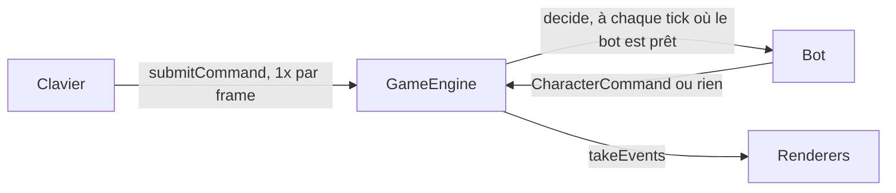
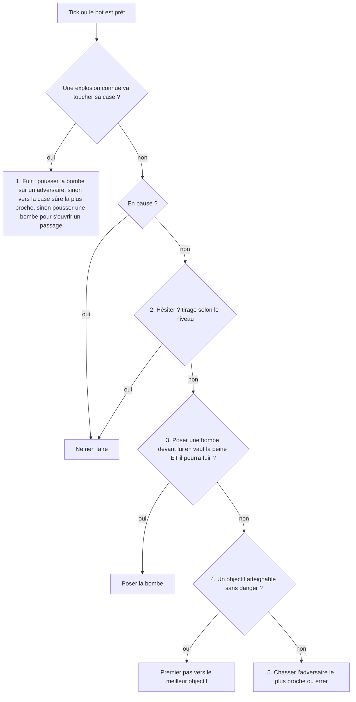

# Personnages pilotés par l'ordinateur (`lib/bot`)

Ce document explique comment les bots sont conçus : où ils se branchent dans le moteur, comment ils « voient » la partie, comment ils décident, ce qui distingue les trois niveaux de difficulté, et comment tout cela est testé. Il est écrit pour quelqu'un qui découvre l'IA de jeu : chaque notion est introduite avant d'être utilisée.

## 1. En une phrase

À chaque tick où son personnage peut agir, un bot calcule **quand chaque case va exploser** (`DangerMap`), puis **où il peut aller sans mourir et en combien de temps** (`ReachMap`), et choisit dans une liste de règles ordonnées (fuir, poser une bombe, aller vers le meilleur objectif, errer) ; il répond par une `CharacterCommand` ordinaire, exactement comme le clavier.

## 2. Où le bot se branche : `PlayerController`

Le moteur (`GameEngine`) avance par ticks fixes de 1/60 s. Le clavier, lui, soumet des commandes une fois par frame avec `submitCommand()`. Pour un bot, ce n'est pas assez précis : si la frame dure 3 ticks, il raterait les ticks intermédiaires, et la partie dépendrait du framerate.

Le moteur expose donc une interface (`lib/engine/src/player_controller.h`) :

```cpp
class PlayerController {
public:
    virtual std::optional<CharacterCommand> decide(const GameEngine& engine, PlayerId id) = 0;
};
engine.setController(id, std::make_unique<Bot>(BotDifficulty::Hard, seed));
```

- Le moteur appelle `decide()` **lui-même, à chaque tick où le joueur est prêt** (vivant, pas en train de marcher, délai écoulé), à l'étape 1 du tick, dans l'ordre des ids.
- La commande renvoyée suit exactement le même chemin qu'une commande clavier (`GameEngine::execute`) : un bot ne peut rien faire qu'un humain ne puisse pas faire, et il subit les mêmes délais (`moveTicks`, `turnTicks`, `placeBombTicks`…).
- `std::nullopt` signifie « je ne fais rien ce tick-ci » ; le bot sera redemandé au tick suivant.
- Un joueur contrôlé ignore `submitCommand()`. `setController(id, nullptr)` le rend au clavier.
- Le bot ne lit le jeu qu'à travers `const GameEngine&` : il ne peut pas tricher en modifiant l'état.

Conséquence importante : **même graine + mêmes commandes = même partie**, quel que soit le framerate. Le bot tire son hasard de son propre `Random` (SplitMix64, déjà utilisé pour les upgrades), initialisé avec une graine à la construction. C'est testé (`BotMatchTest`).



## 3. Ce que le bot sait du temps : la `DangerMap`

### 3.1 Le problème

Une bombe explose 2 s (120 ticks) après sa pose, en croix, et tue quiconque se trouve sur une case touchée **au tick de l'explosion**. Savoir « quelles cases sont dangereuses » ne suffit pas : une case touchée dans 100 ticks est parfaitement traversable maintenant. Le bot a besoin d'une **ligne du temps** par case.

### 3.2 Ce qu'elle contient

`DangerMap::predict(bombes, grille, tickRate)` produit, pour chaque case :

- `hitsAt(case)` : la liste triée des ticks où une explosion la touche ;
- `freeFrom(case)` : le premier tick où l'on peut y marcher : `0` si elle est libre, le tick qui suit l'explosion pour une bombe ou une caisse qui va être détruite, `Forever` pour un mur ou une caisse qu'aucune bombe n'atteint ;
- `getCalmTick()` : le tick à partir duquel plus rien ne change (toutes les bombes ont explosé).

**Convention de temps** : le tick 0 est le tick en cours (celui où le bot décide). Une bombe à qui il reste `n` ticks de mèche explose au tick `n - 1` (`explosionTick`). Une explosion au tick `t` tue ceux qui sont sur la case **après** les commandes de ce tick : quitter une case au tick `t` suffit pour échapper à son explosion au tick `t`.

### 3.3 Comment elle est calculée

On rejoue les explosions **sur une copie de la grille**, dans l'ordre exact où `BombManager::update` les ferait (par tick, puis dans l'ordre du vecteur de bombes) :

1. pour chaque bombe, `Blast::compute` (la **seule** règle de forme d'explosion du projet, aussi utilisée par le jeu et la zone de danger rouge) donne la croix ;
2. chaque case de la croix reçoit le tick de l'explosion ;
3. la caisse touchée en bout de bras est détruite sur la copie : une bombe plus tardive pourra passer à travers, exactement comme dans le jeu.

Il n'y a pas de réaction en chaîne dans ce jeu (une bombe n'en déclenche pas une autre), donc chaque bombe explose à la fin de sa propre mèche : la prédiction est **exacte** tant que personne ne pose ou ne pousse de nouvelle bombe. Le test `PredictionsMatchTheBombManager` le vérifie case par case et tick par tick contre le vrai `BombManager`.

### 3.4 La perception (temps de réaction)

`Bot::perceive()` construit la `DangerMap` du point de vue d'un bot : ses propres bombes sont toujours connues, celles des autres seulement après `reactionTicks` de mèche. Une bombe non remarquée **bloque quand même sa case** (on la voit, on ne peut pas marcher dessus) mais son explosion n'est pas prévue. C'est le principal levier qui rend le niveau facile plus lent à réagir.

## 4. Où le bot peut aller : la `ReachMap`

### 4.1 Une recherche de chemin dans l'espace et le temps

Un pathfinding classique (BFS, Dijkstra, A*) cherche le plus court chemin sur une grille **fixe**. Ici la grille change avec le temps : des cases deviennent mortelles à un tick précis, d'autres s'ouvrent. `ReachMap::explore()` cherche donc dans des **états** `(case, orientation, tick où le personnage peut agir à nouveau)`.

Depuis un état, le personnage peut faire exactement ce que le moteur permet :

| Action | Effet | Durée | Condition de sécurité |
|---|---|---|---|
| avancer | il est sur la case suivante immédiatement | `moveTicks` (10) | la case suivante est libre à ce tick (`freeFrom`) et n'explose pas pendant ces 10 ticks |
| tourner | change d'orientation sur place | `turnTicks` (5) | sa case n'explose pas pendant ces 5 ticks |
| attendre | reste sur place | jusqu'au prochain « événement » | sa case n'explose pas pendant l'attente |

L'orientation compte car, dans ce jeu, il faut d'abord se tourner (5 ticks) avant d'avancer : aller à droite puis en bas coûte un virage de plus que tout droit. Le résultat est donc un vrai temps de trajet en ticks, pas une distance en cases.

### 4.2 Pourquoi attendre peut être la meilleure option

Exemple (test `WaitingLetsAnExplosionPassFirst`) : la seule sortie passe par une case qui explose dans 3 ticks. Y entrer maintenant, c'est y être au moment de l'explosion. La bonne réponse est d'attendre 4 ticks, puis de passer. Une recherche sans le temps ne trouverait aucun chemin (ou un chemin mortel).

Attendre tick par tick multiplierait les états (chaque case visitée ~120 fois). Le bot n'attend donc que **jusqu'à un instant où quelque chose change autour de lui** : juste après une explosion sur une case voisine, juste à temps pour être prêt après une explosion deux cases plus loin, ou quand une case voisine s'ouvre. Ces instants sont précalculés une fois par case.

### 4.3 « Pour de bon »

Le résultat de la recherche est, pour chaque case (et chaque orientation), **le premier tick où le personnage peut s'y tenir pour de bon**, c'est-à-dire sans qu'aucune explosion ne la touche ensuite, et **la première action à faire maintenant** pour y arriver aussi vite (`firstStep`, une direction à donner à `CharacterCommand::move`, ou rien pour attendre).

- `nearestSafeCell()` : la case sûre atteignable le plus tôt, la porte de sortie quand on est menacé ;
- `canSurvive()` : existe-t-il au moins une case sûre atteignable ? C'est la question posée avant chaque pose de bombe.

### 4.4 Algorithme et coût

- Les états sont traités par tick croissant (une file « à seaux », un seau par tick, qui garde un ordre déterministe) : le premier état sûr trouvé pour une case est forcément le plus rapide.
- Avant `getCalmTick()`, un même `(case, orientation)` peut être visité à plusieurs ticks (repasser après une explosion). Après, la grille ne change plus : seule la première visite compte (c'est un Dijkstra classique).
- `Scope::UntilSafe` arrête la recherche dès que les premières cases sûres sont trouvées : suffisant pour fuir ou pour `canSurvive()`, et bien moins cher.

Mesures (4 bots difficiles sur les 4 cartes, ~56 000 ticks) : **médiane 10 µs par tick** pour les 4 bots, 99,9 % des ticks sous **0,6 ms**, pire tick 0,9 ms. Une frame à 60 fps dure 16,7 ms.

## 5. Comment le bot décide : `Bot::decide()`

Une **liste de règles ordonnées** (on s'arrête à la première qui s'applique). C'est volontairement simple et lisible : on sait toujours pourquoi un bot a fait ce qu'il a fait (`getIntent()` le dit, les tests s'en servent).



### 5.1 Fuir

Si la `DangerMap` perçue dit que sa case va exploser :

1. (difficile) s'il fait face à une bombe et que la pousser enverrait **plus** d'adversaires dans son souffle tout en le laissant sauf, il la pousse ;
2. sinon il fait le premier pas vers `nearestSafeCell()` (éventuellement « attendre ») ;
3. s'il n'existe aucune issue à pied, il essaie de pousser une bombe voisine (en se tournant d'abord si besoin) si cela lui rouvre une issue ;
4. sinon il est condamné et ne fait rien.

Ce test de danger est refait **à chaque tick**, même pendant une pause : il ne coûte qu'une `DangerMap`.

### 5.2 Poser une bombe là où il est

La bombe tombe sur la case **en face** du personnage (règle du jeu). Le bot évalue ce qu'elle vaudrait (`bombValue`) :

- `+ blockValue` par caisse détruite (sauf si une autre bombe va déjà la détruire) ;
- `+ attackValue` par adversaire dans le souffle (de la « pression ») ;
- `- upgradeValue` par bonus qu'elle détruirait ;
- `+ trapValue` (difficile) si un adversaire proche **ne pourrait plus s'échapper** : on calcule la `ReachMap` de l'adversaire, comme s'il jouait parfaitement, avec la bombe hypothétique.

Si la valeur est positive, il vérifie qu'il pourra fuir (`canEscapeAfterPlacing`) : on simule la pose sur une **copie du `BombManager`** (la vraie règle de pose, limite de bombes comprise), on recalcule la `DangerMap`, et on demande à la `ReachMap` si une case sûre reste atteignable alors que le bot reste immobile pendant `placeBombTicks`. Le niveau difficile ajoute une **anticipation** : il faut aussi pouvoir fuir si chaque adversaire à moins de 4 cases posait une bombe tout de suite devant lui (c'est ainsi que les bots difficiles évitent de se faire enfermer dans un couloir).

Si poser serait mortel, la case est **mise de côté 60 ticks** (`RejectTicks`) pour que le bot n'y reste pas planté.

### 5.3 Choisir un objectif

Pour chaque case atteignable **pour de bon**, le bot liste les objectifs possibles :

- un bonus utile (pas déjà au maximum) : valeur `upgradeValue` ;
- un « poste de tir » : se tenir sur cette case, tourné vers une case libre, pour y poser une bombe de valeur positive (caisses ou adversaires).

Chaque objectif reçoit le score `valeur × 1000 / (temps de trajet en ticks + 20)` : un objectif deux fois plus intéressant vaut d'aller deux fois plus loin, et la constante 20 empêche un objectif voisin d'écraser tout le reste. Le niveau difficile vérifie en plus le piège (`trapValue`) sur les 3 meilleurs postes d'attaque. Le bot fait le premier pas vers le meilleur (ou, avec la probabilité `mistakePercent`, vers un objectif au hasard).

Il ne pose pas la bombe en route : quand il arrive sur le poste, c'est la règle 5.2 qui la pose (après la vérification de fuite).

### 5.4 Rien à faire

Si aucun objectif n'existe (pas de bombe disponible, plus de caisses…), le bot s'approche de l'adversaire le plus proche (normal, difficile) ou erre vers une case au hasard à moins de 1,5 s (facile). S'il n'a vraiment rien à faire, il se repose 6 ticks avant de réfléchir de nouveau (sauf danger).

## 6. Les trois niveaux

Le cerveau est **le même** pour tous ; seul le `BotProfile` change (`BotProfile::forDifficulty`).

| Réglage | Facile | Normal | Difficile | Effet |
|---|---|---|---|---|
| `reactionTicks` | 30 (0,5 s) | 12 (0,2 s) | 0 | délai avant de remarquer la bombe d'un autre |
| `hesitationPercent` / `Ticks` | 30 % / 24 | 8 % / 12 | 0 | pauses « humaines » hors danger |
| `mistakePercent` | 25 % | 8 % | 0 | objectif choisi au hasard |
| `maxBombs` | 1 | 2 | 8 | bombes posées en même temps (si ses bonus le permettent) |
| `blockValue` | 10 | 10 | 10 | intérêt pour les caisses |
| `upgradeValue` | 5 | 25 | 40 | intérêt pour les bonus |
| `attackValue` | 5 | 30 | 30 | intérêt pour viser un adversaire |
| `trapValue` | 0 | 0 | 100 | cherche les pièges sans issue |
| `anticipationRange` | 0 | 0 | 4 | se méfie des bombes que les voisins pourraient poser |
| `pushesBombs` | non | non | oui | pousse les bombes sur les adversaires |
| `huntsOpponents` | non (erre) | oui | oui | va chercher l'adversaire quand il n'a rien à faire |

Résultats mesurés en duel (32 duels de 3 minutes : 4 cartes × 4 graines × 2 ordres d'apparition) : difficile bat facile 9 à 1, difficile bat normal 3 à 1, normal bat facile 3 à 0. Les autres duels sont nuls après 3 minutes : deux bots qui voient tout esquivent très bien ; c'est contre un humain qu'ils deviennent dangereux.

Pour régler un niveau, il suffit de modifier les valeurs de `forDifficulty` ; les tests `BotProfileTest` fixent l'ordre attendu (facile < normal < difficile) et `HardBotsWinMoreDuelsThanEasyOnes` vérifie que la hiérarchie tient en jeu.

## 7. Exemple déroulé

Le bot est en (1, 1), tourné vers le bas, une caisse en (1, 3), rien d'autre autour (test `ItDropsABombToBreakTheBlockItFacesWhenItCanGetAway`).

1. `DangerMap` : aucune bombe, sa case n'est pas menacée.
2. Règle 5.2 : la bombe irait en (1, 2) ; son souffle (rayon 1) touche (1, 1), (1, 3), (0, 2), (2, 2). Valeur : une caisse = 10 > 0.
3. Vérification de fuite : bombe hypothétique en (1, 2), elle exploserait au tick 119. Le bot reste sur place les 15 ticks de pose, puis : se tourner vers la droite (ticks 15 à 19), avancer en (2, 1) au tick 20, prêt au tick 30. (2, 1) n'est jamais touchée : case sûre atteignable, `canSurvive()` est vrai.
4. Il pose. Au tick 15, de nouveau prêt, il constate que sa case va exploser : règle 5.1, `nearestSafeCell()` = (2, 1), premier pas = `move(Right)` (qui ne fait que tourner), puis `move(Right)` au tick 20.

## 8. Ce que le bot ne fait pas (limites connues)

- Il ne prévoit pas les **futures** bombes des adversaires, sauf l'anticipation du niveau difficile (une bombe tout de suite, devant chaque voisin). Un bot peut donc encore se faire enfermer par une bombe posée après sa décision.
- Il ne coopère pas avec les autres bots : chacun joue pour soi.
- La vérification de piège est faite sur la position **actuelle** de l'adversaire ; elle est refaite au moment de poser.
- Les poids (valeurs, `TravelBias`) sont réglés empiriquement par simulation (bots contre bots sur les 4 cartes).

Pistes : un niveau « expert » qui simulerait plusieurs coups adverses, des bots qui tiennent compte du joueur humain en priorité, ou des profils différents par bot dans une même partie (l'interface le permet déjà : un `Bot` par `PlayerId`).

## 9. Tests

| Suite | Ce qu'elle prouve |
|---|---|
| `GameEngineControllerTest` (`tests/engine`) | le moteur n'appelle un contrôleur que quand son joueur est prêt, ignore alors le clavier, rend la main avec `nullptr`, n'appelle plus un joueur mort |
| `DangerMapTest` | ticks d'explosion, murs et caisses, caisse détruite qui ouvre la voie à une bombe plus tardive, bombe non remarquée, **accord tick par tick avec le vrai `BombManager`** |
| `ReachMapTest` | plus court chemin avec virages, murs, sortie d'une explosion, cul-de-sac sans issue, **attendre qu'une explosion passe**, traverser une case libérée, délai initial, et suivre les premiers pas dans le vrai moteur sauve le personnage |
| `BotProfileTest` | l'ordre facile < normal < difficile de chaque réglage |
| `BotTest` / `BotDifficultyTest` / `BotLevelTest` | fuir une bombe (3 niveaux), ne jamais poser une bombe sans issue, seul sur chaque carte pendant une minute : casse au moins 20 caisses sans jamais se tuer (4 cartes × 3 niveaux), aller vers un poste de tir, ramasser un bonus, ignorer un bonus inutile, tuer un adversaire immobile, piège sans issue, poussée de bombe (difficile) vs fuite (normal), hésitations du niveau facile |
| `BotMatchTest` | même graine = même partie, autre graine = autre partie, même partie à 30, 60 ou 144 fps, le difficile gagne plus de duels que le facile |

## 10. Fichiers

- `lib/engine/src/player_controller.h` : l'interface ; `GameEngine::setController` / `hasController`.
- `lib/bot/src/bot_profile.h` : `BotDifficulty`, `AllBotDifficulties`, `BotProfile::forDifficulty`.
- `lib/bot/src/danger_map.{h,cpp}` : la ligne du temps des explosions.
- `lib/bot/src/reach_map.{h,cpp}` : la recherche espace-temps.
- `lib/bot/src/bot.{h,cpp}` : les règles de décision.
- `exe/main.cpp` : crée un `Bot` par adversaire choisi dans le menu (voir [menu.md](menu.md)).
