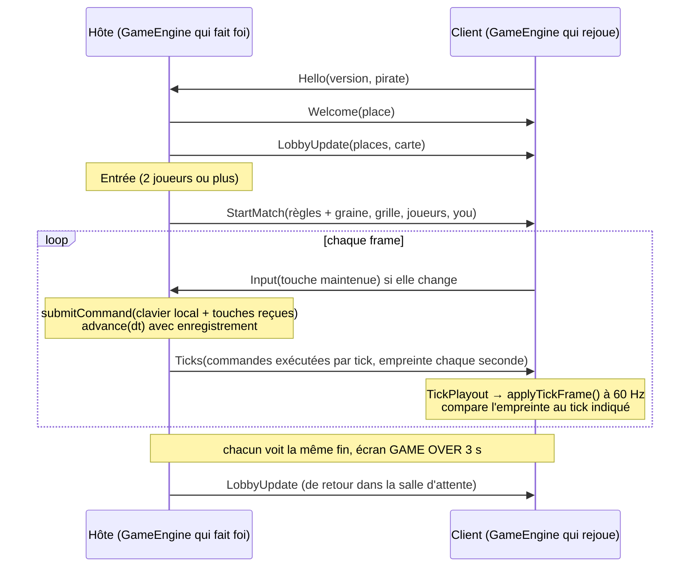

# Multijoueur en réseau local (`lib/network`)

De 2 à 4 joueurs, chacun sur son ordinateur, tous connectés au **même réseau** (le même Wi-Fi). L'un d'eux **héberge** la partie (le capitaine), les autres la **rejoignent** (les matelots). Ils se retrouvent dans une **salle d'attente**, puis jouent la partie, et reviennent ensemble dans la salle d'attente après l'écran de fin pour une revanche.

Maquette validée : « Rassembler l'équipage » (proposition A, « Le pont d'embarquement », pour la salle d'attente ; écran « Chercher un navire » ; rangée « mode » du menu).

## Jouer

1. **Le capitaine** : dans le menu, rangée « mode », choisir le navire couronné qui émet (**Héberger**), choisir son pirate et la carte, puis `Entrée`. La salle d'attente s'ouvre ; le terminal affiche le port utilisé.
2. **Les matelots** : rangée « mode », choisir la longue-vue (**Rejoindre**), choisir son pirate, puis `Entrée`. L'écran « Chercher un navire » liste les parties annoncées sur le réseau : `Q`/`D` (ou `←`/`→`) pour choisir, `Entrée` pour monter à bord.
   - Si aucune partie n'apparaît (réseau qui bloque la diffusion, voir les limites), lancer le jeu avec l'adresse du capitaine : `bomberman --join 192.168.1.20` (ou `--join 192.168.1.20:50123` si le capitaine n'a pas pu prendre le port par défaut : son terminal affiche le port utilisé).
3. **Salle d'attente** : chacun peut changer de pirate avec `Q`/`D`. Deux joueurs ne peuvent pas avoir le même pirate : ceux déjà pris sont sautés. Le capitaine lance la partie avec `Entrée` dès que **2 joueurs** sont présents ; les matelots voient un sablier. `Échap` quitte la salle (si c'est le capitaine, la partie est fermée pour tout le monde).
4. **En partie** : mêmes touches qu'en solo (`Z`/`Q`/`S`/`D`, `Espace`, `Entrée`). `Tab` : le capitaine ramène tout le monde dans la salle d'attente ; un matelot quitte la partie et revient au menu. `Échap` quitte le jeu. Les touches `1`–`4` (changer de carte) ne servent qu'en solo.
5. **Fin de partie** : le dernier pirate debout gagne. Un joueur mort regarde la suite **à vitesse normale** (pas d'accélération ×4 comme en solo : les autres sont des humains qui jouent encore). Chaque écran affiche son propre verdict (victoire pour le gagnant, défaite pour les autres, égalité si tout le monde meurt), puis tout le monde revient dans la salle d'attente.

Le multijoueur se joue **uniquement entre humains** : pas de bots pour compléter les places libres (choix validé). Avec les modes réseau, les rangées « difficulté » et « adversaires » du menu sont assombries et sautées par le curseur ; avec « Rejoindre », la rangée « carte » l'est aussi (c'est le capitaine qui choisit).

## Choix techniques (validés)

| Sujet | Choix | Alternatives écartées |
|---|---|---|
| Synchronisation | **Lockstep piloté par l'hôte** : seul l'hôte fait tourner la partie avec autorité ; il diffuse à chaque frame les commandes que son moteur a exécutées, tick par tick ; chaque client les rejoue sur son propre `GameEngine` | Snapshots d'état (l'hôte envoie tout l'état, le client ne fait qu'afficher) : plus robuste aux écarts de calcul, mais il aurait fallu rendre tout l'état sérialisable et restaurable (personnages, bombes, upgrades, grille), et le rendu n'aurait plus été piloté par les événements du moteur |
| Transport | **TCP** avec `sfml-network` (déjà compilé avec SFML, aucune nouvelle dépendance ; SFML désactive l'algorithme de Nagle) | UDP + fiabilité maison (inutile sur un réseau local, et le lockstep a besoin de **toutes** les commandes, dans l'ordre) ; Asio (nouvelle dépendance) |
| Découverte | **Diffusion UDP** (broadcast) par l'hôte toutes les 0,5 s + `--join <adresse>` en secours | Saisie de l'adresse IP à l'écran : impossible, le jeu n'embarque aucune police |
| Places libres / déconnexions | **Humains seulement** ; un joueur qui se déconnecte en pleine partie laisse son pirate **immobile** sur la carte (il peut encore être tué) | Bots pour compléter, ou un bot qui reprend le pirate d'un joueur parti |
| Salle d'attente | Proposition **A**, « Le pont d'embarquement » | B « La passerelle », C « Le registre de l'équipage » |

Choix pris par défaut et annoncés : la carte complète est envoyée par l'hôte (un matelot n'a pas besoin du fichier de niveau) ; chaque joueur a un pirate unique ; la version du protocole est vérifiée à la connexion ; après l'écran de fin, tout le monde revient dans la salle d'attente ; si l'hôte part, la partie s'arrête pour tous.

## Architecture

```
exe/main.cpp ─ écrans : Menu → (Search →) Lobby → Match → Lobby …
exe/match.*  ─ construction d'une partie (solo / hôte / client), rendu, fin de partie
   │
   ├── lib/render   MatchSetupRenderer (rangée mode : Solo / Héberger / Rejoindre)
   │                LobbyRenderer (salle d'attente), DiscoveryRenderer (recherche)
   │                MenuArt (dessins partagés : navire, longue-vue, couronne, sablier, ondes…)
   ├── lib/network  protocole, salle d'attente, sessions hôte/client, découverte, cadence client
   │      └── SFML::Network (TCP/UDP)
   └── lib/engine   GameEngine (enregistrement des commandes, empreinte de l'état), MatchReferee
```

`lib/network` dépend de `engine` (et donc de `grid`, `character`…) mais **jamais de `render`** : il se teste sans fenêtre, en boucle locale (`127.0.0.1`). Les modèles de pirate y voyagent sous forme d'**index** dans `AllCharacterModels` (`exe/match.cpp` fait la conversion avec `modelAt()` / `indexOfModel()`).

### Côté moteur (`lib/engine`)

- `GameEngine::setCommandRecording(true)` : chaque commande remise à un joueur prêt pendant l'étape 1 d'un tick est enregistrée (`ExecutedCommand{tick, player, command}`), qu'elle ait eu un effet ou non. `takeExecutedCommands()` les récupère. Désactivé par défaut (inutile en solo).
- Rejouer ces commandes, tick par tick, sur un autre moteur construit avec la même grille et les mêmes règles (graine comprise) reproduit **exactement** la partie : les mêmes joueurs sont prêts aux mêmes ticks, donc exécutent les mêmes commandes (`GameEngineReplayTest.ReplayingTheRecordedCommandsReproducesTheMatch` le vérifie sur 1200 ticks à 4 joueurs, avec des upgrades).
- `GameEngine::stateHash()` : empreinte FNV-1a 64 bits de tout l'état (tick, état du générateur aléatoire, grille, personnages avec leurs flottants **bit à bit**, délais, stats, bombes, upgrades). Deux moteurs qui ont joué la même partie ont la même empreinte.
- `MatchReferee` :
  - `SpectatorRule::RealTime` (réseau) : pas d'accélération ni de limite de temps quand le joueur local est mort ;
  - le verdict est pris **tick par tick** à partir des événements `PlayerKilled` passés à `update(engine, dt, events)` : la partie est finie au premier tick où il reste au plus un joueur, quels que soient les morts des ticks suivants de la même frame. Sans cela, l'hôte (qui joue par exemple 2 ticks dans une frame) et un client (qui les joue en 2 frames) pourraient ne pas désigner le même gagnant si deux joueurs meurent à un tick d'écart.

### Côté réseau (`lib/network`)

| Classe | Rôle |
|---|---|
| `protocol.h` | Messages, constantes (ports, version), encodage/décodage avec `sf::Packet`, `writeGrid`/`readGrid`, `makeTickFrames()` / `applyTickFrame()` |
| `Lobby` | Logique pure des 4 places de la salle d'attente : place 0 = l'hôte, première place libre pour un nouveau venu, pirates uniques, nombre de places limité par les points d'apparition de la carte |
| `Connection` | Une liaison TCP **non bloquante** : file d'envoi (un paquet partiellement envoyé est repris au `flush()` suivant), ne renvoie que des messages complets, se ferme si le pair part, envoie un message invalide, ou ne lit plus rien (plus de 1200 paquets en attente) |
| `HostSession` | Écoute (TCP), annonce la partie (UDP) tant qu'on est dans la salle d'attente, accepte/refuse les clients, tient le `Lobby`, démarre la partie (`StartMatch` personnalisé pour chacun), collecte les touches des clients (`takeCommand()`), relaie les ticks (`sendTicks()`), ramène tout le monde dans la salle (`returnToLobby()`) |
| `ClientSession` | Se connecte (bloquant au plus 3 s), dit `Hello`, suit la salle d'attente, reçoit `StartMatch`/`Ticks`/`BackToLobby`, envoie ses touches (`sendInput()`, seulement quand elles changent) |
| `DiscoveryBeacon` / `DiscoveryListener` | Annonce UDP de l'hôte ; écoute et liste des hôtes entendus (oubliés après 2,5 s de silence, dans l'ordre où ils ont été entendus) |
| `TickPlayout` | Cadence côté client : met en tampon les ticks reçus par rafales et les joue au rythme de 60 Hz, rattrape d'un coup s'ils s'accumulent ; garde les empreintes de l'hôte jusqu'au tick concerné |

Rien ne bloque la boucle de jeu, à une exception près : la connexion d'un client (au plus 3 s si l'adresse ne répond pas ; immédiate sur un réseau local quand l'hôte est là).

## Le protocole

Ports : **TCP 53790** (`DefaultGamePort`, l'hôte écoute ; s'il est pris, un autre port libre est utilisé et annoncé), **UDP 53791** (`DiscoveryPort`, les clients écoutent les annonces). Chaque message est un `sf::Packet` (TCP les garde entiers et dans l'ordre) : un octet de type puis ses champs. Un paquet mal formé (type inconnu, tronqué, valeurs absurdes, octets en trop) ferme la connexion.

| Message | Sens | Contenu |
|---|---|---|
| `Hello` | client → hôte | version du protocole (`ProtocolVersion` = 1), pirate souhaité |
| `Welcome` | hôte → client | la place attribuée (1 à 3) |
| `Refused` | hôte → client | raison : salle pleine, autre version du jeu, partie en cours (puis l'hôte ferme la connexion) |
| `LobbyUpdate` | hôte → clients | les 4 places (prise ou non, pirate) et la carte complète |
| `ChangeModel` | client → hôte | pirate libre suivant (+1) ou précédent (−1) |
| `StartMatch` | hôte → chaque client | `GameRules` complètes (graine comprise), grille, joueurs (place + pirate, dans l'ordre des `PlayerId`), `you` = le joueur du destinataire |
| `Input` | client → hôte | la commande que le clavier maintient (ou rien) |
| `Ticks` | hôte → clients | les commandes exécutées pendant les ticks d'une frame de l'hôte (consécutifs, le premier numéro puis, par tick, la liste `(joueur, commande)`), et éventuellement une empreinte `(tick, stateHash)` |
| `BackToLobby` | hôte → clients | la partie est abandonnée (`Tab` de l'hôte) |

Annonce UDP (`Beacon`) : un nombre magique (`0xB0B50A7E`, pour ignorer les autres datagrammes), la version, le port TCP, le pirate de l'hôte, les places prises / disponibles, la carte. Seuls les hôtes de la même version sont listés. L'hôte cesse de s'annoncer pendant une partie (un nouveau venu serait refusé).

Taille : une frame de 60 Hz avec 4 joueurs qui agissent tous fait une vingtaine d'octets ; le trafic est négligeable.

## Déroulement d'une partie



### Les entrées

Le clavier d'un client ne pilote pas son personnage directement : `ClientSession::sendInput()` envoie la commande **maintenue** à l'hôte, seulement quand elle change (appuyer, relâcher, changer de direction). L'hôte la soumet à son moteur à chaque frame, exactement comme une touche locale maintenue (même règle : une commande arrivée pendant que le joueur est occupé est abandonnée, jamais mise en file). Un appui très bref (appuyé puis relâché avant que l'hôte ne lise) n'est pas perdu : la dernière commande appuyée est gardée jusqu'à la frame suivante de l'hôte (`HostSession::takeCommand()`).

### Côté client : rejouer et cadencer

Le client **ne fait jamais avancer son moteur seul** : il n'appelle pas `advance()`, il joue les ticks de l'hôte avec `applyTickFrame()` (soumettre les commandes du tick, puis `tick()`). Ces ticks arrivent par rafales irrégulières (une par frame de l'hôte, plus la gigue du Wi-Fi) ; les jouer dès réception ferait saccader le plateau. `TickPlayout` les met en tampon et les joue au rythme de l'hôte (même `FixedTimestep` à 60 Hz) ; s'il en accumule plus de 4 (`MaxBacklog`, après un trou réseau), il rattrape d'un coup en n'en gardant qu'un. Le décalage avec l'hôte reste donc d'au plus quelques ticks en plus de la latence réseau.

Le rendu est ensuite **identique au solo** : les événements du moteur du client (`takeEvents()`) pilotent les animations, l'arbitre décide de la fin.

### Le déterminisme

Le lockstep n'envoie jamais l'état : il repose sur le fait que deux moteurs qui reçoivent les mêmes commandes calculent la même chose, bit pour bit. C'est vrai pour tout le code entier (positions, délais en ticks, hasard `Random` SplitMix64, jamais les distributions de `<random>`). Les seuls flottants de la simulation sont les durées (`Character::update`, `Bomb::update`, avec leur `TimeTolerance`) ; pour qu'ils soient identiques sur toutes les machines, le projet est compilé avec **`-ffp-contract=off`** (`cmake/CommonMacros.cmake`) : sans cela, Clang fusionne `a*b+c` en une seule instruction FMA sur ARM (Mac Apple Silicon), dont l'arrondi diffère d'une compilation x86-64. MSVC (`/fp:precise`) ne fusionne pas.

**Détection d'une désynchronisation** : chaque seconde de jeu (`ChecksumInterval` = 60 ticks), l'hôte joint à ses `Ticks` l'empreinte de son état (`stateHash()`) au dernier tick envoyé ; le client la compare quand son moteur atteint ce tick. En cas d'écart, il l'écrit une fois dans la console (`Desynchronised from the host at tick …`) ; la partie continue (voir les limites).

### Fin de partie, retour, départs

- Chaque ordinateur décide seul de la fin, à partir de son moteur (identique) : même tick décisif, même gagnant (`MatchReferee`, voir plus haut). Le moteur de l'hôte s'arrête (plus de ticks envoyés), les clients jouent les ticks déjà reçus.
- Après l'écran de fin, l'hôte repasse en salle d'attente (`returnToLobby(false)`, sans prévenir : chaque client revient seul à la fin de **son** écran de fin) et renvoie un `LobbyUpdate`.
- `Tab` de l'hôte en pleine partie : `BackToLobby` à tous, qui quittent la partie immédiatement.
- Un client qui part (fermeture du jeu, `Tab`, `Échap`, réseau coupé) : en salle d'attente sa place se libère ; en partie, son pirate reste **immobile** (plus aucune commande), sa place sera libre pour la partie suivante.
- L'hôte qui part : chaque client détecte la connexion fermée et revient au menu (le terminal l'indique).
- Un nouveau venu pendant une partie est refusé (`MatchInProgress`) ; il peut retenter une fois la salle rouverte.

## Les écrans (`lib/render`)

Mêmes principes que le menu : espace de 1600x900 adapté à l'écran avec des bandes noires (`viewFor()`), coordonnées de la maquette, aucun texte, traits fins opaques, tout en `Mesh`.

- **Menu** (`MatchSetupRenderer`) : la rangée « mode » propose Solo (le boucanier face au squelette), **Héberger** (le navire, le boucanier couronné sur la voile, des ondes) et **Rejoindre** (une longue-vue et des ondes). `MatchSetup::isRowActive()` dit quelles rangées comptent pour le mode ; les autres sont assombries et `moveFocus()` les saute.
- **Salle d'attente** (`LobbyRenderer`, proposition A) : quatre panneaux côte à côte, chacun sous un fanion de la couleur de sa place (rouge, bleu, vert, or : les bandanas de `CharacterRenderer::paletteForPlayer(place)`, que les pirates portent aussi en partie) avec 1 à 4 points ; la couronne au-dessus de la place 0. Une place prise montre son pirate debout sur un anneau de sa couleur ; la sienne a un cadre doré, son pirate sautille entre deux flèches ; un nouveau venu apparaît en grandissant (0,35 s). Une place libre montre la silhouette en pointillés d'un corps et des points d'attente. En bas : la miniature de la carte, les ondes réseau, quatre lanternes (allumées par joueur présent) et le bouton de lancement (hôte) ou un sablier (matelots).
- **Chercher un navire** (`DiscoveryRenderer`) : ciel de nuit au-dessus du pont, longue-vue qui balaie la mer depuis son trépied avec son cône de lumière, une carte par partie entendue (3 par page) : le pirate du capitaine sur son navire, couronné, la miniature de la carte, un point par place (coloré si prise, en pointillés si libre). Sans partie, la longue-vue reste seule avec de gros points d'attente.
- `MenuArt` (`menu_art.h`) regroupe les dessins partagés par ces écrans (planches, cadres, bouton de lancement, flèches, couronne, sablier, ondes, navire, longue-vue, points, silhouette en pointillés).

## Tests

`tests/network` (`network_tests`), sans fenêtre :

- `ProtocolTest` : aller-retour de chaque message, règles complètes et grille comprises ; rejet des paquets mal formés ; les 4 niveaux livrés traversent le réseau intacts ; annonces et datagrammes étrangers ; regroupement des commandes par tick ; un tick ne s'applique qu'à son numéro.
- `LobbyTest` : place de l'hôte, premières places libres, pirates uniques (remplacement, changement qui saute les pris et boucle), salle pleine (4 joueurs ou les points d'apparition de la carte).
- `TickPlayoutTest` : cadence de 60 Hz, jamais de tick non reçu, lissage d'une rafale, rattrapage, empreintes attendues au bon tick.
- `SessionTest` (vrais sockets en boucle locale, hôte et clients dans le même processus) : rejoindre la salle, pirates distincts, salle pleine, mauvaise version, départ qui libère la place, refus pendant une partie, chaque client reçoit son joueur, touches maintenues et appuis brefs, **partie complète rejouée à l'identique par deux clients** (10 s de commandes pseudo-aléatoires, frames de l'hôte de 1 à 3 ticks, empreintes vérifiées en cours de route et à la fin), partie abandonnée, client qui part en pleine partie, hôte qui part, connexion vers personne.
- `DiscoveryTest` : un hôte en attente est entendu (une seule fois) puis oublié quand il disparaît ; il ne s'annonce plus pendant une partie.

Et dans les autres bibliothèques : `GameEngineReplayTest` (enregistrement, rejeu, empreinte), `MatchRefereeTest` (temps réel, verdict indépendant du découpage en frames), `MatchSetupTest` (modes, rangées actives), `LobbyRendererTest` / `DiscoveryRendererTest` (géométrie des écrans).

## Limites techniques

- **Réseaux qui isolent les appareils** (Wi-Fi public, d'hôtel, d'entreprise, réseau « invité » de certaines box) : les ordinateurs ne peuvent pas se parler du tout ; ni la découverte ni `--join` ne fonctionnent. Rien à faire côté jeu : utiliser un autre réseau (par exemple le partage de connexion d'un téléphone).
- **Diffusion bloquée** : certains réseaux ou routeurs filtrent le broadcast UDP sans isoler les appareils. Les parties n'apparaissent pas, mais `--join <adresse de l'hôte>` fonctionne.
- **Autorisations du système** : au premier lancement, macOS demande d'autoriser le jeu (ou le Terminal qui le lance) à accéder au **réseau local** (macOS 15 et suivants) et à **accepter les connexions entrantes** (pare-feu) ; Windows Defender pose la même question à l'hôte. Si on refuse, personne ne peut rejoindre (ou le client ne voit aucune partie).
- **Deux joueurs sur le même ordinateur** : un seul peut écouter les annonces (port UDP 53791) ; l'autre utilise `--join 127.0.0.1`. (Utile pour tester, sans intérêt pour jouer : le jeu est en plein écran.)
- **Latence** : un client voit ses propres actions avec un aller-retour réseau de retard (en général 5 à 30 ms en Wi-Fi, avec des pics), plus le tampon de cadence (0 à 4 ticks). Il n'y a **pas de prédiction locale** : sur un Wi-Fi chargé, le pirate d'un client peut réagir avec un léger temps de retard. L'hôte, lui, n'a aucune latence (avantage de l'hôte).
- **Déterminisme entre plateformes** : garanti sur un même type de machine et de compilateur ; entre un Mac et un PC Windows, il repose sur IEEE 754 et `-ffp-contract=off`, ce qui suffit en pratique pour nos quelques additions de flottants, mais n'est pas prouvé. Une désynchronisation est **détectée** (empreinte), pas **corrigée** : il faudrait pour cela que l'hôte envoie un instantané de l'état (voir les évolutions).
- **Même version obligatoire** : un client d'une autre version du protocole est refusé. Le protocole ne garantit pas non plus qu'un même numéro de version donne la même simulation si les règles du moteur ont changé entre deux compilations : tout le monde doit jouer la même version du jeu.
- **Pas de jeu par Internet** (NAT, serveur relais), **pas de reconnexion** en pleine partie, **pas de rejoindre en cours de partie**.
- **Aucun texte** : le jeu n'affichant pas de texte, une adresse IP ne peut être ni affichée ni saisie à l'écran ; les messages (port choisi, refus, perte de connexion, désynchronisation) vont dans le terminal.
- **Connexion bloquante** : se connecter à une adresse qui ne répond pas gèle l'écran au plus 3 s.
- **Un client qui ne lit plus** (gel, débogueur) est déconnecté par l'hôte après ~20 s d'envois en attente, pour ne pas pénaliser les autres.

## Évolutions possibles

- Resynchronisation : sur désaccord d'empreinte, l'hôte enverrait un instantané complet de l'état.
- Prédiction côté client (rejouer localement ses propres commandes en avance, puis corriger) pour masquer la latence.
- Bots pour compléter les places libres, ou reprendre le pirate d'un joueur parti (le flux de commandes le permet déjà : l'hôte enregistre aussi les commandes des contrôleurs).
- Rejoindre en cours de partie (avec un instantané), reconnexion d'un joueur parti.
- Multijoueur local sur un même clavier (deux `KeyboardController` avec d'autres touches) : le moteur le permet déjà.
